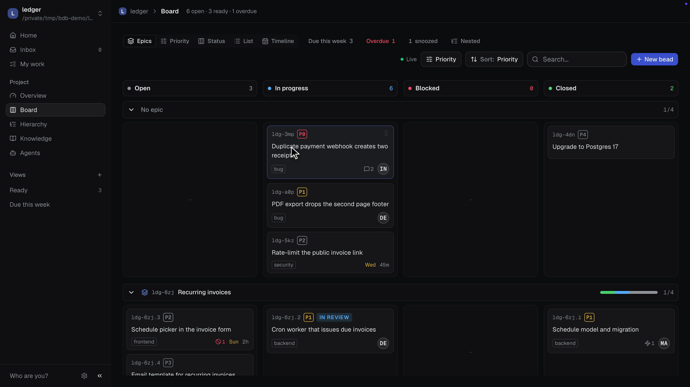

# bd board

Visual kanban board and multi-project dashboard for [`bd` (beads)](https://github.com/steveyegge/beads).

`bd-board` is intentionally local-first: it discovers bead-enabled repositories on disk, reads data through the local `bd` CLI, and renders a fast dashboard for day-to-day planning. It now also has an early Tauri desktop shell spike so the same UI can run outside the browser.

## Features

- Home across projects: what needs you now (open P0s, blocked or stale work, unreadable projects), projects ordered by urgency, your assigned beads, and recent updates.
- Project overview: needs attention, epic progress, ready to pick up, in progress, and the latest decisions from Knowledge.
- Board view grouped by status or by epic swimlanes.
- Priority filtering, text search, and sort controls with URL state.
- Epic progress from child beads.
- Bead detail modal with markdown description, acceptance criteria, comments, parent and child navigation.
- Drag-and-drop status updates with mouse and keyboard sensors.
- Create beads, add comments, edit fields, and delete beads, enabled by default.
- Schedule: due dates, estimates and snooze (defer until a date) on every bead, with overdue, due-soon and "due this week" filters on the board.
- Label chips with autocomplete, and a relations editor (blocks, blocked by, related, duplicates, supersedes) in the bead detail.
- Command palette (`Cmd/Ctrl+K`) to jump to beads, projects and actions, plus keyboard shortcuts for navigation and editing (press `?` for the list).
- Ready view with one-click claim, backed by `bd ready --explain`.
- Agents panel: who holds a lease, heartbeats, human gates and agent pools.
- Inbox and My work, built from the events journal, with a per-project read cursor.
- Project settings: general, custom statuses, agent pools and integrations.
- Linear integration: connect a team and link beads to Linear issues.
- Saved views: store a filter, grouping and sort per project, or personally.
- List view with grouping and bulk actions (status, priority, assignee, labels, close).
- Epics timeline built from bead dates.
- Insights: throughput, cycle time and burn-up over a selectable range.



## Requirements

- Node.js 24+.
- pnpm 10+.
- `bd` 1.3.0 or newer; 1.3.4 recommended (1.3.3 fixed security and data-loss bugs). Older versions are not supported (the board relies on the events journal for live updates).
- Repositories with `.beads/metadata.json` under the configured roots.

**Live updates:** the board subscribes to `bd events tail --follow` and refetches only when the journal reports a change (plus a 60 s safety refetch). When a project's journal is off, the board enables it automatically by running `bd config set events-journal true` in that project (a one-time write to its beads config) and shows a toast. It falls back to 8 s polling only while connecting or after a transient feed error.

## Setup

Web development:

```bash
pnpm install
cp .env.example .env.local
pnpm dev
```

Open http://localhost:3009.

Desktop development:

```bash
pnpm install
pnpm desktop:dev
```

**Development tools:** The project includes `mise.toml` to pin exact versions of Node.js, pnpm, and bd. Run `mise install` to set them up for consistent development across the team.

## Desktop App

The desktop app is a Tauri v2 shell around the same React/TanStack UI. It is
intended for local use only: it reads bead projects from your machine and calls
the local `bd` binary through Tauri commands.

Desktop data flow:

- Web mode uses TanStack Start server functions and the local `bd` adapter.
- Desktop mode uses Tauri commands for project discovery, board data, bead
  details, comments, and knowledge, plus the same create/update/delete
  mutations as web mode.
- No bead database, `.beads` data, or Lavra memory is bundled into the app.

Desktop packaging:

```bash
pnpm desktop:prepare
pnpm desktop:build
```

`pnpm desktop:prepare` builds the TanStack Start app in SPA mode, copies the
generated `.output/public` assets into the repo-root `dist/`, and writes
`dist/index.html` from the generated `_shell.html`. This matters because Tauri
serves `frontendDist` as static assets; packaging a handmade `index.html` with
only the client script leaves the installed app on a blank screen.

Tauri is configured with:

```json
"frontendDist": "../dist"
```

The path is relative to `src-tauri/tauri.conf.json`, so the installed app embeds
the repo-root `dist/` directory.

On macOS, the release build writes:

```text
src-tauri/target/release/bundle/macos/bd board.app
src-tauri/target/release/bundle/dmg/bd board_0.1.0_aarch64.dmg
```

Windows packaging is part of the Tauri roadmap for this project, but the current
verified artifact is the macOS build.

Desktop troubleshooting:

- If the app opens but shows no projects, check that `bd` is available on
  `PATH` or set `BD_BIN`.
- The app uses an explicit project registry at `~/.config/bd-board/projects.json`.
  Click "Open project" to register a beads workspace, or "Init project" to create one.
- If the desktop bridge fails, the home page shows a diagnostic card. When the
  bridge is healthy, that card stays hidden.
- If the installed app opens to a blank screen, rerun `pnpm desktop:build` and
  confirm `dist/index.html` exists and was generated from `_shell.html`.

## Configuration

### Project Registry

The app stores a list of registered beads projects at `~/.config/bd-board/projects.json`:

```json
{
  "version": 1,
  "projects": [
    {
      "id": "ravo",
      "path": "/Users/you/Code/jeanpfs-ai/beads/ravo",
      "label": "ravo"
    }
  ]
}
```

Use the **Open project** and **Init project** buttons in the app UI to manage projects. The app resolves each project's beads location by calling `bd where --json`, so it automatically honors all beads configuration mechanisms (embedded, shared server, proxied, global, redirects).

### Environment Variables

- `BD_BIN`: path to the `bd` binary. Defaults to `bd`, with `/opt/homebrew/bin/bd` as a fallback.
- `BD_BOARD_TIMING=1`: log every `bd` call with its duration to stderr, in both the web server and the desktop app. Useful to see where time goes.

The desktop shell uses the same `BD_BIN` configuration. **`BD_ROOTS` is no longer used.**

Reads and writes are both enabled by default: the app executes local `bd` mutations (create, edit, comment, status update, delete) with no separate opt-in.

## Commands

```bash
pnpm dev
pnpm typecheck
pnpm check
pnpm exec eslint --max-warnings=0
pnpm test
pnpm audit:prod
pnpm validate
pnpm desktop:prepare
pnpm desktop:build
```

## Architecture

```text
src/
  lib/
    bd.ts                 local bd CLI adapter
    server.ts             TanStack Start server functions
    server-validation.ts  server-function input validation
    sort.ts               filtering and sorting helpers
    types.ts              bead/project types and status mapping
  routes/
    __root.tsx            app shell
    index.tsx             project dashboard
    p.$project.tsx        board route
  components/
    board-header.tsx
    board-swimlanes.tsx
    kanban-column.tsx
    bead-card.tsx
    bead-detail-modal.tsx
    create-bead-dialog.tsx
scripts/
  prepare-desktop-build.mjs
src-tauri/
  tauri.conf.json
  src/
    desktop.rs
    lib.rs
```

The app does not store its own database. It shells out to `bd` with `node:child_process` and parses JSON output.

`docs/bd-schema.json` documents that contract as a JSON Schema: the `Bd*` definitions describe what each `bd` command emits, and the remaining definitions describe the normalized shapes the UI consumes.

## Safety Model

## E2E (WebdriverIO)

End-to-end tests run through WebdriverIO with the Tauri service (`@wdio/tauri-service`). They are split in two suites because the two things they verify need different runtimes:

| Suite   | Command                         | Runtime                                        | Covers                                                                    |
| ------- | ------------------------------- | ---------------------------------------------- | ------------------------------------------------------------------------- |
| Native  | `pnpm e2e:build && pnpm e2e`    | Real app binary, embedded WebDriver provider   | UI behaviour against the shipped shell (`e2e/specs/native`)               |
| Browser | `pnpm dev` + `pnpm e2e:browser` | Frontend in Chrome against the Vite dev server | Flows that stub backend commands and native dialogs (`e2e/specs/browser`) |

On macOS the native suite uses the embedded provider (`tauri-plugin-wdio-webdriver`); `tauri-driver` has no macOS support. The build activates the `wdio` Rust feature and the `VITE_WDIO` frontend flag, so production binaries never carry the test surface.

IPC mocking only works in the browser suite: Tauri defines `window.__TAURI_INTERNALS__.invoke` as non-writable and non-configurable, and `@wdio/tauri-plugin` only wraps the `withGlobalTauri` global, which the bundled `@tauri-apps/api` never calls.

The native suite pins the embedded WebDriver port (`e2e/wdio.conf.ts`); the default 4445 is shared with any other Tauri app running its own suite, and a session will silently attach to the wrong app.

`bd-board` is not designed as a hosted multi-tenant app. Run it locally and bind it only to trusted interfaces: writes are always enabled, so anyone who can reach the app can mutate local bead data.

## License

MIT
